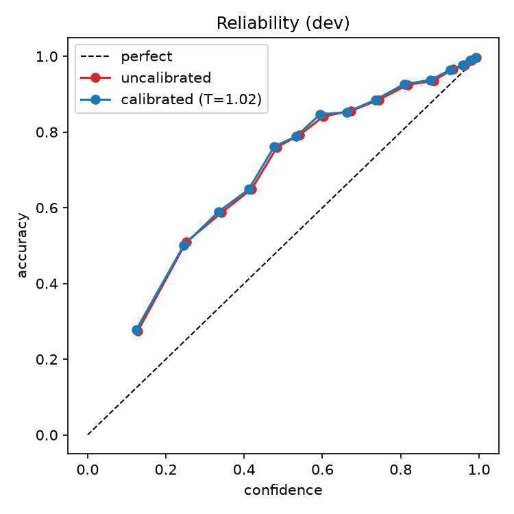
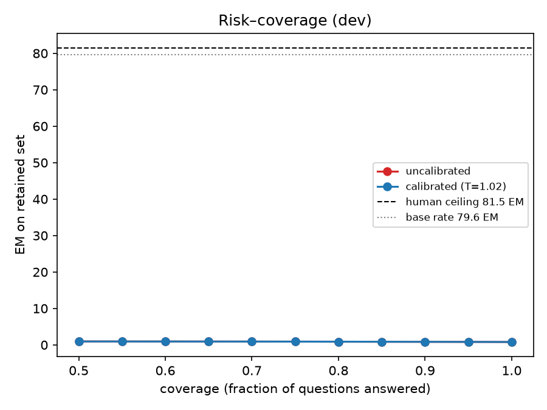
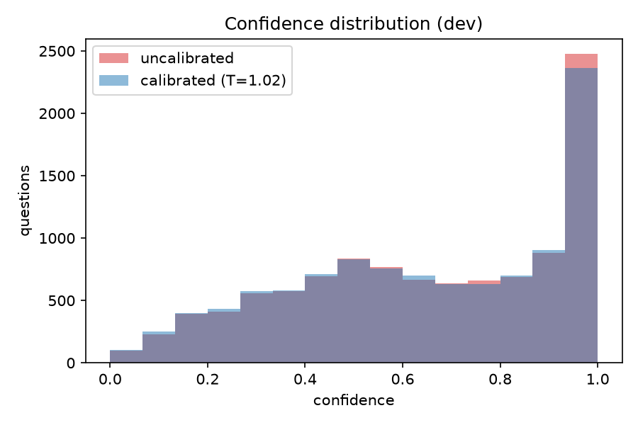

# Confidence output v1 — temperature scaling: run and report

**Date.** 2026-10-28 (run); pipeline designed 2026-10-27.
**Branch / commit.** `experiment/temperature-confidence` @ `4a555b6`
(fix commits this session: `0cdc7d3`, `423a1a5`, `4a555b6`).
**Headline.** The emitted answer probability carries real information (Brier Skill
Score **+0.062**, risk–coverage EM **95.0 at 50% coverage**), but a single
temperature fitted on the validation partition **does not transfer to dev** and
makes every proper score slightly worse. The cause is measured, not assumed: val
and dev differ in gold convention, so their base rates differ by **9.7 points**,
and a monotone rescaling cannot move an operating point. **The uncalibrated
probability is the reported signal; the transferred temperature is reported as a
negative result.**

---

## 1. Setup

| item | value |
|---|---|
| model | `google-bert/bert-base-uncased`, fine-tuned 3 epochs, `max_length 384`, `doc_stride 128`, `n_best_size 20`, `max_answer_tokens 128`, lr 2e-5, bs 8/16, warmup 0.1, wd 0.01 |
| seed | 42 |
| training rows | 78,858 questions / 79,655 features (train sha256 `352766…f955`) |
| calibration partition | 8,741 val questions / 45 articles (`runs/baseline/validation-v1.1.json`) |
| report partition | 10,570 dev questions (`data/raw/dev-v1.1.json`), used **once** |
| `full_train` | **false** — the 8,741 val rows stay out of training (handoff decision 4) |
| val loss | 0.9428 |

Reproduction metrics (independent of this work, and matching the teammate's
baseline):

| partition | EM | F1 | n |
|---|---|---|---|
| val | 69.9462 | 82.7531 | 8,741 |
| dev | 79.6026 | 87.4969 | 10,570 |

Environment. Analysis (all of §4–§7) ran locally in `.venv`:
`python 3.14.6`, `numpy 2.5.4`, `matplotlib 3.11.2`, `pytest 9.1.1`
(no torch, no transformers — intentional). The cluster env is the
`requirements.txt` pins: `torch 2.6.0`, `transformers 4.52.4`, `datasets 3.6.0`,
`accelerate 1.6.0`, `numpy 1.26.4`, `pyarrow 20.0.0`. Only numpy is needed for
fitting; matplotlib is deliberately kept out of the pinned training env.

Method (v1, unchanged from the handoff): confidence = the model's own span
probability `softmax(s)[i*] · softmax(e)[j*]` from the winning window, no
renormalisation over legal spans; one temperature fitted on val by NLL; EM/F1
cannot change because temperature scaling is monotone.

---

## 2. Fitted temperature (validation)

```
T = 1.0200   n = 8741   val base rate = 0.6995
half-split (by article): T_A = 1.0300, T_B = 1.0100, Δ = 0.0200
```

Δ = 0.02, inside the ±0.05 gate: one parameter over 8,741 rows has nothing to
overfit, so the check passes and dev is safe to report on.

**This is the first substantive result, and it contradicts the design
prediction.** The handoff expected `T < 1` ("v1 confidence is systematically
deflated ⇒ temperature must raise it"). It does not: on the partition it is
fitted on, v1's probability is close to correctly scaled by NLL, and `T ≈ 1.02`
flattens rather than sharpens. The deflation is real (§3) but it is *relative to
dev's base rate*, not something val's own likelihood asks to be corrected.

---

## 3. Report on dev (one-shot)

|  | EM | F1 | mean_c | base | Brier | BSS | ECE | NLL |
|---|---|---|---|---|---|---|---|---|
| uncalibrated | 79.6026 | 87.4969 | 0.6503 | 0.7960 | **0.1523** | **+0.0617** | 0.1457 | 0.4548 |
| +T (T=1.02) | 79.6026 | 87.4969 | 0.6439 | 0.7960 | 0.1543 | +0.0495 | 0.1522 | 0.4599 |

Trivial-baseline Brier floor `base(1−base)` = **0.1624**; BSS is relative to it.

Gate outcomes, computed as data (`runs/baseline/calibration-report.json`):

| check | result |
|---|---|
| 1. EM/F1 identical to `metrics.json` | **pass** — answers unchanged, so no offset/mask/argmax bug |
| 2. NLL decreased | **fail** — 0.4548 → 0.4599 |
| 3. Brier and ECE both decreased | **fail** — 0.1523 → 0.1543, 0.1457 → 0.1522 |

Checks 2–3 failing is **not** a code defect here; §4 shows the mechanism.

### 3.1 The signal is deflated, as predicted

`mean_c` 0.6503 against base 0.7960 — a **−14.6 point** systematic
under-confidence, visible in the first equal-mass reliability bin as
confidence 0.129 against observed accuracy 0.275. So the design note "the
un-renormalised product is not a distribution over answers, and sits below 1"
is confirmed *as a level error*.

### 3.2 …but a single temperature cannot fix it across partitions

| | val | dev |
|---|---|---|
| base rate of `y` | 0.6995 | 0.7960 |
| gold convention | 1 gold/question | ~3 golds/question |

The partitions differ by **+9.66 points** of base rate (dev is easier). A
temperature is monotone: it changes the *sharpness* of the distribution, never
its operating point. Fitted on val, it pushes dev's already-low confidences
lower still (`mean_c` 0.6503 → 0.6439), so Brier, ECE and NLL all worsen.

The diagnostic that isolates this — **computed for diagnosis only, never
reported as the method, since it fits on dev**:

```
T* fitted on dev (NLL)     = 0.7100      (vs 1.0200 on val)
T  minimising Brier on dev = 0.6000
dev with T* (diagnostic)    Brier 0.1342  ECE 0.0718  NLL 0.4158
```

Sharpening would improve every score by a wide margin; the direction reverses
between partitions precisely because the base rates differ. This is the
handoff's own §9 rationale for deferring Platt — now measured rather than
assumed. Consequence for the write-up: **temperature scaling transfers only when
the base rate transfers**, so a calibrator must be fitted on a held-out sample
drawn from the *target* distribution's gold convention (or absorb the shift with
a bias term, which is Platt/v2, not pure T).

### 3.3 Why `T ≈ 1` on val: val is already calibrated

| partition | base | mean_c | ECE | BSS | AUC |
|---|---|---|---|---|---|
| val | 0.6995 | 0.6754 | **0.0454** | **+0.2240** | 0.800 |
| dev | 0.7960 | 0.6503 | **0.1457** | +0.0617 | 0.829 |

The same signal is nearly calibrated on val (ECE 0.045, `mean_c` within 2.4
points of base) and badly deflated on dev (−14.6 points). Calibration is
therefore a property of the **signal × distribution** pair, not of the signal
alone, and a temperature fitted on val is correctly ≈ identity there.

Note also that dev's *ranking* is **better** than val's (AUC 0.829 vs 0.800) and
its *Brier* is better (0.1523 vs 0.1631), yet its BSS is much worse (+0.062 vs
+0.224), because BSS is normalised by `base(1−base)` which is only 0.1624 at
dev's 0.796 base rate. A signal near the base rate earns little credit, so the
level error is punished twice. BSS must be read next to AUC and risk–coverage.

### 3.4 What a calibrator could achieve (headroom, measured)

Same dev data, different calibrators. Rows marked ORACLE are fitted on dev and
are **diagnostics only** — they are not a proposed method (gotcha 10):

| calibrator | fitted on | dev Brier | dev BSS | dev ECE |
|---|---|---|---|---|
| uncalibrated | — | 0.1523 | +0.062 | 0.1457 |
| T = 1.02 (**the shipped transfer**) | val | 0.1543 | +0.050 | 0.1522 |
| T = 0.60 | dev (ORACLE) | 0.1327 | +0.183 | 0.0593 |
| Platt `a·logit+b`, a=0.767 b=+0.249 | **val** | **0.1391** | **+0.143** | 0.1171 |
| Platt `a·logit+b`, a=0.955 b=+1.043 | dev (ORACLE) | 0.1213 | +0.253 | 0.0144 |
| floor `base(1−base)` | — | 0.1624 | 0.000 | — |

Three readings:

1. Temperature scaling is **not** inert — fitted on the target distribution it
   moves dev Brier 0.1523 → 0.1327 and BSS +0.062 → +0.183. It is the *transfer*
   from val that fails, not the method.
2. A **2-parameter** map on the logit does transfer partially: Platt fitted on
   val reaches dev Brier 0.1391, roughly half of the gap to the oracle. Its bias
   term absorbs part of the 9.7-point base-rate shift that a pure scaling cannot.
   The residual 0.1391 → 0.1213 is what genuinely requires labels from the target
   convention.
3. Uncalibrated Brier 0.1523 is only 6% below the trivial floor; oracle Platt is
   25% below it. **Most of the headroom is level, not ranking** — which is the
   direct motivation for v2 renormalisation.

---

## 4. Figures



Both curves sit **above** the diagonal across the entire range (under-confidence).
The calibrated curve is slightly *worse* — the visual form of the failing checks.



Selective prediction, uncalibrated signal (the calibrated curve is identical
because T is monotone):

| coverage | 50% | 60% | 70% | 80% | 90% | 95% |
|---|---|---|---|---|---|---|
| EM on retained | **95.0** | 93.0 | 91.0 | 88.0 | 85.0 | 83.0 |

Reference lines: dev base rate 79.6 EM (answer everything) and the measured
inter-annotator ceiling **81.5 EM**. The signal beats the annotator ceiling once
coverage is ≤ ~60%, i.e. abstaining on the least confident 40% buys accuracy
above what an average human annotation achieves on the full set.



---

## 5. Error-rate targeting (the most persuasive result)

Threshold chosen on **val** so the retained set has ≤ 5% error, then the
achieved error and coverage measured on **dev**, per signal:

| signal | τ (from val) | dev coverage | dev error | n |
|---|---|---|---|---|
| span probability | 0.9208 | **25.35%** | 1.87% | 2,679 |
| margin (top1−top2) | 3.6969 | 21.21% | 1.96% | 2,242 |
| −entropy | −0.2093 | **26.02%** | 1.71% | 2,750 |

All three transfer and land under the 5% target with margin to spare. Ranking
quality (AUC against correctness): dev — prob 0.829, margin 0.757, entropy 0.838;
val — prob 0.800, margin 0.758, entropy 0.804. Entropy edges out probability here
despite being the cheaper signal, which is worth a sentence in the discussion but
is a single data point.

Note the handoff's caveat (a): calibrated vs uncalibrated is *ranking-identical*
(T is monotone), so this table is the cross-signal comparison, not a calibration
result. It is also immune to the §3.2 base-rate problem, because thresholds
transfer by rank.

---

## 6. Engineering: two bugs found this session

Both were invisible to a "22 tests green" local suite, because the local venv has
no torch/transformers and `predict.main()` had therefore never executed anywhere.

1. **`NameError` killed both predict jobs** (`0cdc7d3`). `predict.py` passed an
   unbound `max_answer_tokens` to `best_spans`; the value lives in the config.
   Jobs `1026140/1026141` died *after* completing a full BERT pass, so no
   artifacts existed. Fixed, plus a `symtable`-based test that flags globals
   never bound in any `src/` module — it reproduces `main: max_answer_tokens` on
   the offending commit.
2. **val/dev sidecar collision** (`0cdc7d3`). `scores.npz`/`confidence.json` were
   hardcoded into `--output`'s parent, which both chained jobs share, so dev
   would have overwritten the val cache and left no val cache at all — inviting
   a fit on dev. Names now derive from the predictions filename
   (`predictions.json` → `scores.npz`, `val-predictions.json` → `val-scores.npz`).
3. **Inverted margin signal** (`4a555b6`). `_signal` negated `span_margin` even
   though a larger top1−top2 gap already means more confidence, so targeting
   ranked the *least* confident first and reported margin `UNREACHABLE`
   ("best prefix error 30.05% at k=8741" — no prefix beat keeping everything)
   while its own AUC was 0.757. NaN margins (no legal span) were also treated as
   maximally confident, because `np.argsort` puts NaN last in a descending sort.
   The synthetic fixture had masked this: there margin genuinely is noise, and
   the handoff recorded that as "do not extrapolate from the fixture". Fixed
   margin now reaches 21.21% dev coverage at 1.96% error. Regression tests assert
   the "higher = more confident" contract for all three signals and fail 3/3
   against the pre-fix module.

`calibrate report` also changed to evaluate the §6 gates **as data**: it writes
the table, JSON and plots, then raises. Previously an assertion aborted before
any artifact was written.

---

## 7. What v1 establishes, and what to do next

Established:

- The model's own span probability is **informative on rank** (AUC 0.829 on dev,
  95 EM at 50% coverage, 25% coverage at 1.87% error). It is worth emitting.
- Its *level* is wrong on dev (−14.6 points, ECE 0.146) while being right on val
  (ECE 0.045): calibration is pair-specific, not a property of the signal.
- A single global temperature is the **wrong tool for a cross-convention
  transfer**. Fitted on val it is ≈ no-op on val and harmful on dev. On the
  target distribution itself it works (Brier 0.1523 → 0.1327).
- A 2-parameter affine map (Platt) transfers **partially** from val
  (Brier 0.1391); the remainder needs labels from the target convention.
- Most of the remaining headroom is level, not ranking (uncalibrated is 6% below
  the trivial Brier floor; oracle Platt is 25% below), which is the argument for
  v2.

Next, in order of expected value:

1. **v2: renormalise over legal spans** (`renormalised_span_probability`, already
   implemented and tested, not yet wired into `report`). Predicted to fix the
   *level* error, which temperature cannot. Compare ECE/Brier on dev against
   §3's numbers.
2. **Base-rate-aware calibration** — Platt (`a·logit + b`, measured above at dev
   Brier 0.1391 from a val fit) or a per-partition bias term fitted on a
   held-out sample from the target convention (oracle 0.1213).
3. Keep the **error-rate targeting** table as the headline for the report: it is
   rank-based, so it survives base-rate shifts, and it is the one capability a
   ranking-only score cannot provide.

## 8. Reproduce

```bash
# fit T on val (local, numpy only)
PYTHONPATH=src .venv/bin/python -m qa_baseline.calibrate fit \
  --scores runs/baseline/val-scores.npz --data runs/baseline/validation-v1.1.json \
  --predictions runs/baseline/val-predictions.json --output runs/baseline/calibration.json

# report on dev (one-shot; expect checks 2-3 to fail per section 3.2)
PYTHONPATH=src .venv/bin/python -m qa_baseline.calibrate report \
  --scores runs/baseline/scores.npz --data data/raw/dev-v1.1.json \
  --predictions runs/baseline/predictions.json --calibration runs/baseline/calibration.json \
  --metrics runs/baseline/metrics.json --output runs/baseline/calibration-report.json \
  --plot-dir runs/baseline/plots

# error-rate targeting
PYTHONPATH=src .venv/bin/python -m qa_baseline.calibrate target \
  --val-scores runs/baseline/val-scores.npz --val-data runs/baseline/validation-v1.1.json \
  --val-predictions runs/baseline/val-predictions.json --scores runs/baseline/scores.npz \
  --data data/raw/dev-v1.1.json --predictions runs/baseline/predictions.json \
  --calibration runs/baseline/calibration.json --target-error 0.05 \
  --output runs/baseline/target-report.json
```

## 9. Caveats

- Val was already used for checkpoint selection (`load_best_model_at_end`); T adds
  one more parameter fitted on it. Δ(half-split) = 0.02 bounds the optimism.
- `scores.npz` rows are the **winning window only**; multi-window questions (3% of
  dev, ≤6 windows) take confidence from that window alone, so per-window
  probabilities are not strictly comparable.
- ECE uses 15 **equal-mass** bins; it is not a proper scoring rule, which is why
  Brier/BSS lead and ECE only diagnoses.
- Never compare ECE across val and dev — different gold conventions (§3.2).
- The margin signal scans the full window row, not the 20×20 `n_best` grid
  (docstring corrected in `4a555b6`); it is an ablation, not a proposal.
